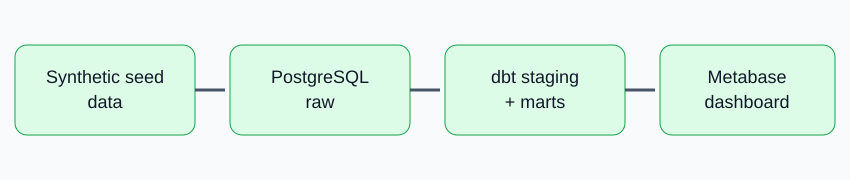

# Nairobi Rental Market Warehouse



A dbt/PostgreSQL warehouse using 500 deterministic synthetic listings across Nairobi neighbourhoods. It does not scrape property websites. Synthetic data avoids unauthorised copying and makes the demo reproducible.

## Run
```bash
docker compose up --build
```
Postgres: `localhost:5434`. Metabase: http://localhost:3000 (complete first-run setup and connect to host `db`, port `5432`, database `rentals`, user/password `portfolio`).

Re-run dbt tests: `docker compose run --rm dbt test --profiles-dir .`.

## Models
`raw.rental_listings` -> `stg_listings` -> `dim_neighbourhood`, `dim_property_type`, `fct_rental_listing`.

## Design decisions
dbt keeps transformations versioned and testable. A star schema makes neighbourhood and property-type analysis easy. Synthetic listings are safer than scraping a site whose terms may prohibit automated extraction. Extreme rents are flagged for review rather than silently deleted.
